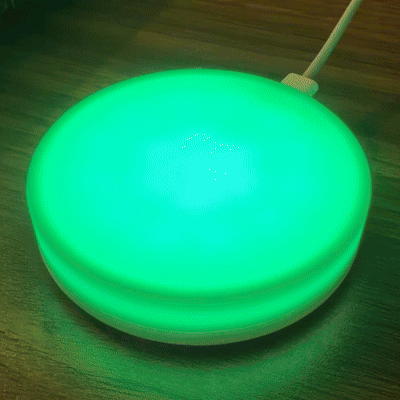

<div align="center">

# AI Work Lamp



**Shows the state of Claude Code with a USB lamp**

[日本語](README.md) ｜ English

</div>

A handy gadget that shows the state of Claude Code while it is working on your request, using the light of a lamp connected by USB.

The Claude Code plugin and the lamp's firmware (Arduino) are managed in this repository.

## Display states

| State | Light | When |
|---|---|---|
| Working | 🔵 Blue light spins | When you send an instruction, and each time a tool is used |
| Done | 🟢 Green, stays lit | When the response has finished |
| Waiting for permission | 🟡 Yellow, blinking | When it has stopped and is asking for permission |
| Off | ⚫ Off | When you exit Claude Code, or when you briefly press the lamp's button |

Holding the button down dims the brightness by one step (100% → 60% → 35% → 20% → 10% → 100%).

The lamp remembers the brightness setting.

## Supported environments

- **Linux**: Confirmed on Ubuntu 22.04
- **Windows**: Confirmed on Windows 11
- **Mac**: Not confirmed

## Usage

Plug the lamp into your PC via USB, then run the following two commands in Claude Code:

```
/plugin marketplace add robohase/ai-lamp
/plugin install ai-lamp@robohase
```

After installing, restart Claude Code.

On Linux, first do the "Linux setup" section below.

When you run several Claude Code sessions at once, the lamp shows the following, in this order:

- If any session is waiting for permission → 🟡 Yellow
- If any session is working → 🔵 Blue
- If all sessions are done → 🟢 Green

## Linux setup

Do this once so that you can write to the USB serial device.

```bash
echo 'SUBSYSTEM=="tty", ATTRS{idVendor}=="1209", ATTRS{idProduct}=="c550", MODE="0666"' | sudo tee /etc/udev/rules.d/99-ai-lamp.rules
sudo udevadm control --reload && sudo udevadm trigger
```

## Controlling the lamp from other tools

Send one line over USB serial with `work` / `done` / `wait` / `off` to switch the lamp to that state (it does not reply).

Linux:

```bash
echo work > /dev/serial/by-id/usb-Deqing_CH55xduino_*
```

Windows (PowerShell): Change `COM6` to the lamp's port number (you can find it under "Ports (COM & LPT)" in Device Manager).

```powershell
$p = New-Object System.IO.Ports.SerialPort COM6; $p.Open(); $p.WriteLine("work"); $p.Close()
```

## Changing the firmware

`firmware/ai_lamp/ai_lamp.ino` is the firmware source (built with [ch55xduino](https://github.com/DeqingSun/ch55xduino)).

1. In the Arduino IDE, under "Preferences" → "Additional Boards Manager URLs", add this URL:

   ```
   https://raw.githubusercontent.com/DeqingSun/ch55xduino/ch55xduino/package_ch55xduino_mcs51_index.json
   ```

2. In the Boards Manager, install "CH55xDuino MCS51"
3. Select the board "CH552 Board", Clock Source "24 MHz (internal), 5V", and USB Settings "Default CDC"
4. With the lamp plugged in, click "Upload"

To revert, upload `ai_lamp.ino` from this repository as-is.

If you can no longer upload, hold the button while plugging in the USB cable to enter upload mode.

## License

MIT
