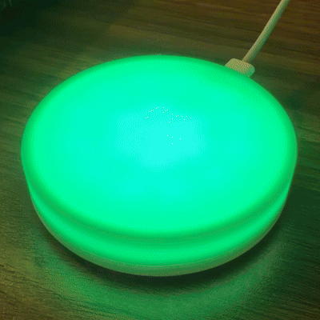

<div align="center">

# AI 作業ランプ



**Claude Code の作業状態を、USB ランプの光で知らせる便利グッズ**

[English](README.en.md) ｜ 日本語

</div>

Claude Code に作業を頼んでいる間の状態を，USB でつないだランプの光で知らせる便利グッズ

Claude Code のプラグインと，内部基板のファームウェア（Arduino）をこのリポジトリで管理してます．

## 表示状態
| 状態 | 光り方 | いつ |
|---|---|---|
| 作業中 | 🔵 青い光がくるくる回る | 指示を送ったとき・ツールを使うたび |
| 完了 | 🟢 緑で点きっぱなし | 返事が終わったとき |
| 許可待ち | 🟡 黄色で点滅 | 許可を求めて止まっているとき |
| 消える | ⚫ 消える | Claude Code を終了したとき・ランプのボタンを短く押したとき |

USB を挿すと，緑がふわっと点いて消える（起動したお知らせ）．

ボタンを長押しすると，明るさが 1 段暗くなる（100% → 60% → 35% → 20% → 10% → 100%）．

明るさは電源喪失時に状態を記憶します．

## 動作環境

- **Linux**: Ubuntu 22.04 で動作確認
- **Windows**: Windows 11 で動作確認
- **Mac**: macOS で動作確認

## 使い方

ランプを USB で PC に挿して，プラグインを入れる．

Linux は先に下の「Linux の設定」をしておく．

Windows は先に [Git for Windows](https://git-scm.com/downloads/win) を入れておく（プラグインの取得に使う）．

### デスクトップアプリ（Claude の Code タブ）の場合

1. 左側の**カスタマイズ**を選ぶ
2. **プラグイン** を選んで，**マーケットプレイスを追加** を選ぶ．
3. **リポジトリから追加**を押し，下記のURLを張り付けて，同期を押す．
```bash
https://github.com/robohase/ai-lamp
```
4. `Ai lamp`を`このコンピューターに追加`を選択する．（追加済みになればインストール完了です）
5. アプリを再起動する

### ターミナルの Claude Code の場合

次の2つのコマンドを実行して，Claude Code を起動し直す．

```
/plugin marketplace add robohase/ai-lamp
/plugin install ai-lamp@robohase
```

### 複数のセッションを動かしているとき

Claude Code を同時にいくつも動かしているときは，次の順で光る．

- どれかが許可待ち → 🟡 黄色
- どれかが作業中 → 🔵 青
- 全部終わった → 🟢 緑

### Linux の設定

最初に 1 回だけ，USB シリアルに書き込めるようにする．

```bash
echo 'SUBSYSTEM=="tty", ATTRS{idVendor}=="1209", ATTRS{idProduct}=="c550", MODE="0666"' | sudo tee /etc/udev/rules.d/99-ai-lamp.rules
sudo udevadm control --reload && sudo udevadm trigger
```

## ほかのツールから光らせる

ランプに USB シリアルで `work` / `done` / `wait` / `off` を 1 行送ると，その状態になる．

Linux:

```bash
echo work > /dev/serial/by-id/usb-Deqing_CH55xduino_*
```

Windows（PowerShell）: `COM6` はランプの番号に変える（デバイスマネージャーの「ポート（COM と LPT）」で見られる）

```powershell
$p = New-Object System.IO.Ports.SerialPort COM6; $p.Open(); $p.WriteLine("work"); $p.Close()
```

## ファームウェアの変更

`firmware/ai_lamp/ai_lamp.ino` がファームウェアのソース（[ch55xduino](https://github.com/DeqingSun/ch55xduino)）．

1. Arduino IDE の「基本設定」→「追加のボードマネージャの URL」に，次の URL を足す

   ```
   https://raw.githubusercontent.com/DeqingSun/ch55xduino/ch55xduino/package_ch55xduino_mcs51_index.json
   ```

2. ボードマネージャで「CH55xDuino MCS51」を入れる
3. ボード「CH552 Board」，Clock Source「24 MHz (internal), 5V」，USB Settings「Default CDC」を選ぶ
4. ランプを挿したまま「書き込み」

元に戻すときは，このリポジトリの `ai_lamp.ino` をそのまま書き込む．

書き込めなくなったときは，ボタンを押しながら USB を挿すと書き込みモードになる．

## ライセンス

MIT
